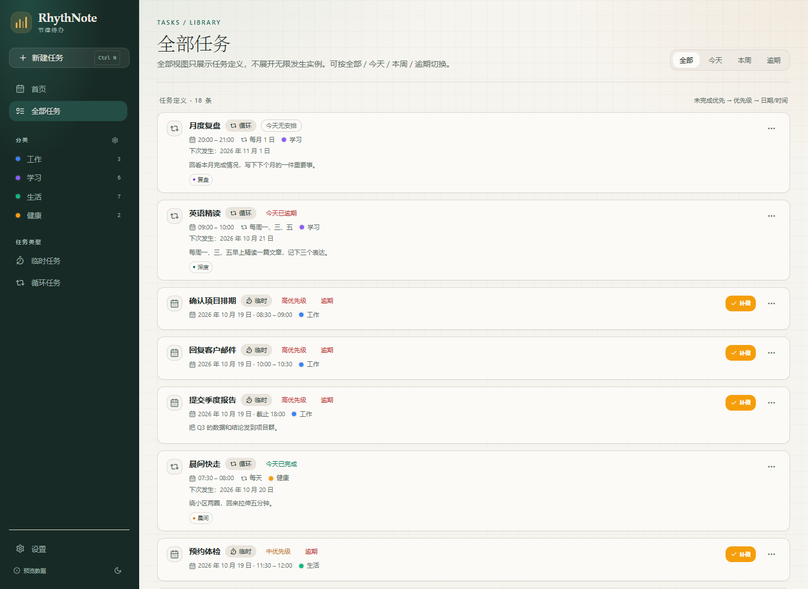

# RhythNote · 节律待办

> 用规则描述重复，用记录保存事实。一个本地优先的个人任务待办 Windows 桌面应用。

RhythNote 把「循环任务」和「每日记录」分开：任务只描述应该发生什么，只有真正打卡、写备注、补做时才写入每日记录。月历不会预生成任何实例，也不会把过去和未来混成一团。


## 当前版本

`v0.1.1` · Windows 10/11 x64

| 文件 | 说明 |
|---|---|
| [RhythNote_0.1.1_x64-setup.exe](https://github.com/zdkwa/RhythNote/releases/download/v0.1.1/RhythNote_0.1.1_x64-setup.exe) | NSIS 安装包，推荐 |
| [RhythNote.exe](https://github.com/zdkwa/RhythNote/releases/download/v0.1.1/RhythNote.exe) | 便携版，直接运行 |
| [GitHub Release](https://github.com/zdkwa/RhythNote/releases/tag/v0.1.1) | 版本发布页与 SHA256 |

安装包未做代码签名。Windows SmartScreen 提示时，选择「更多信息 → 仍要运行」。

> 本地已重新构建 `v0.1.3`（包含首页分区、已打卡天数与检查更新），暂未上传 GitHub；上表仍是已发布的 `v0.1.1`。

## 界面预览

| 首页仪表板 | 日期详情 |
|---|---|
|  |  |
| **全部任务** | **新建 / 编辑任务** |
|  |  |

## 功能

### 首页仪表板

- 顶部显示今天日期、星期和实时时钟，精确到秒。
- 今日完成、待完成、今日节奏、已打卡天数。
- 已打卡天数卡片附本周一至周日的打卡圆点，悬停可查看日期与状态。
- 今日任务分为「循环任务」和「临时任务」两个区域，各自最多展示 2 项。
- 循环任务按距离当前时间从近到远排序；临时任务按当前时段 → 优先级 → 距离当前时间排序。
- 当前任务显示「正在做」，20 分钟内开始的任务显示「即将开始」。
- 月历压缩在右侧，不再独占整页。

### 月历与日期

- 固定 6×7 月历，周一开始，支持月份 URL 同步。
- 未来日期显示「未开始」，不再显示 0/N 或提前标红。
- 循环任务从创建当天开始判定；创建之前不产生未完成状态。
- 日期详情按未完成 / 已完成 / 已暂停 / 历史记录分区。
- 点击日期进入当天安排，月历只读，不生成每日记录。

### 任务与循环

- 临时任务可设置优先级、计划时间段或截止时间。
- 循环任务不显示优先级，固定为中优先级。
- 常用循环节奏：每天、工作日、每周多选、每月、每年。
- 间隔与结束条件折叠在「更多循环设置」中。
- 普通用户界面不提供高级 RRULE 字符串编辑。
- 侧栏「新建任务」和 `Ctrl N` 是唯一全局新建入口。

### 完成、补做与逾期

- 完成按钮统一在任务行右侧。
- 绿色「完成」、橙色「补做」、红色「取消完成」。
- 当天任务超过结束时间 30 分钟后才判定逾期并显示「补做」。
- 没有设置结束时间的任务，到第二天才显示「补做」。
- 过去日期完成会记为补做。

### 记录与归档

- 循环任务卡片支持内联备注，500ms 防抖 + 失焦保存。
- 按日暂停：只暂停某一天，不修改 RRULE，不写每日记录。
- 归档任务停止产生新记录并保留历史；V1 归档不可恢复。
- 支持分类、标签、浅色 / 深色 / 跟随系统。
- 数据保留：每日记录和暂停日期仅保留最近 2 年，启动时自动清理；已打卡天数保留汇总，不随旧明细删除而丢失。

### 检查更新

- 设置 → 通用中手动检查 GitHub Release。
- 只在你点击时访问 `api.github.com`，不会上传任务数据。
- Private 仓库可在本机配置只读 GitHub Token；Token 不会写入项目数据库或上传。
- 发现新版本时可直接打开发布页下载安装包。

### 完全本地

- 无账号、无遥测、无后台同步；除手动检查更新外不发起网络请求。
- 数据保存在本机 SQLite。
- 浏览器预览使用内存演示数据，不会写入桌面数据库。

## 技术栈

| 层级 | 技术 |
|---|---|
| 桌面 | Tauri 2 + Rust |
| 前端 | React 18 + TypeScript + Vite |
| 样式 | Tailwind CSS 3.4 + shadcn/ui 风格组件 |
| 数据 | SQLite（tauri-plugin-sql） |
| 循环 | rrule |
| 日期 | date-fns |
| 状态 | TanStack Query |

## 核心设计

- **规则与记录分离**：循环任务只保存定义与 RRULE，发生实例运行时展开，绝不预生成。
- **稀疏每日记录**：只有打卡、备注、补做、暂停等用户交互才写 `daily_records` / `task_pauses`。
- **未来未开始**：未来日期只表达计划，不表达完成或失败。
- **创建日判定**：循环任务创建前的日期不参与完成统计。
- **本地日期**：业务日期统一 `YYYY-MM-DD`，审计时间戳使用 UTC。

## 开发

需要 Node.js、pnpm、Rust（MSVC toolchain）与 WebView2。

```bash
pnpm install
pnpm dev            # 浏览器预览（内存演示数据）
pnpm typecheck
pnpm test
pnpm build
pnpm tauri dev      # 桌面开发模式（本地 SQLite）
pnpm tauri build    # 生成 Windows NSIS 安装包
```

### 数据位置

```text
%APPDATA%\com.rhythnote.desktop\rhythnote.db
```

卸载应用不会自动删除该数据库；如需彻底清理，请手动删除该目录。

### Windows 运行要求

请使用标准用户运行，或对内置 Administrator 开启 UAC 管理员批准模式后重启。不要使用高完整性管理员令牌直接运行，否则 WebView2 可能创建窗口失败（闪退，异常代码 `0xc0000409`）。

```powershell
reg add "HKLM\SOFTWARE\Microsoft\Windows\CurrentVersion\Policies\System" /v FilterAdministratorToken /t REG_DWORD /d 1 /f
```

若启动失败，请查看 `%TEMP%\RhythNote-crash.log`。

## 目录

```text
src/
  app/          # 路由、QueryClient、错误边界
  components/   # 布局与 shadcn 风格 UI
  data/         # SQLite 客户端、Repository、查询 hooks
  domain/       # 循环展开、状态合并、排序、逾期判定
  features/     # 日历、任务、记录、设置
  hooks/        # 今天、时钟、主题
  lib/          # 日期、RRULE、工具
  pages/        # 页面
  types/        # 领域类型
src-tauri/
  migrations/   # SQLite schema 与 seed
  src/          # Tauri 插件注册与迁移
docs/
  screenshots/  # 界面截图
```

## 验证

- `pnpm typecheck`：通过
- `pnpm test`：30 个测试通过
- `pnpm tauri build`：成功生成 NSIS 安装包

## 版本记录

### 0.1.3

- 首页分为「循环任务」「临时任务」两个区域，各自最多展示 2 项。
- 当前任务标记「正在做」，20 分钟内开始标记「即将开始」。
- 任务按距离当前时间从近到远排序；临时任务优先按优先级。
- 「当前时段」指标替换为「已打卡天数」，并附本周一至周日打卡圆点。
- 本地构建版本，暂未上传 GitHub Release。

### 0.1.2

- 设置 → 通用新增「检查更新」。
- 支持 GitHub Releases 版本比较、打开发布页。
- Private 仓库支持本机只读 Token。
- 当前为本地构建版本，暂未上传 GitHub Release。

### 0.1.1

- 首页改为仪表板，增加顶部日期、实时时钟和紧凑月历。
- 未来日期改为「未开始」，循环任务从创建日开始判定。
- 完成按钮统一右侧，增加绿 / 橙 / 红三态。
- 逾期改为结束时间 30 分钟后；无时间任务次日补做。
- 未完成临时任务按当前时段、优先级、时间排序，最多 5 项。
- 简化新建任务，移除高级 RRULE，循环任务隐藏优先级。
- 统一侧栏新建入口，移除各页面重复的新建按钮。

### 0.1.0

- V1 本地优先任务待办基线版本。

## License

Private project. All rights reserved.
