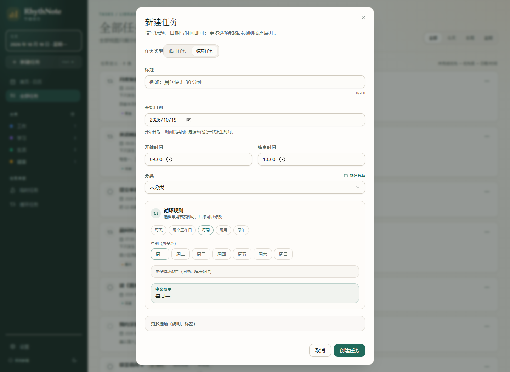

# RhythNote · 节律待办

> 用规则描述重复，用记录保存事实。一个本地优先的个人任务待办 Windows 桌面应用。


## 项目状态

V1.1 体验修订完成：Tauri 2 工程、SQLite 迁移与 Repository、任务 CRUD、循环规则构建器、首页仪表板、紧凑月历、日期详情、每日记录、备注、补做、按日暂停、筛选、归档与设置均已落地，并通过 `typecheck`、单元测试、Vite 构建与 Tauri NSIS 打包验证。

## 下载

| 文件 | 说明 |
|---|---|
| [RhythNote_0.1.1_x64-setup.exe](https://github.com/zdkwa/RhythNote/releases/download/v0.1.1/RhythNote_0.1.1_x64-setup.exe) | Windows x64 NSIS 安装包，推荐 |
| [RhythNote.exe](https://github.com/zdkwa/RhythNote/releases/download/v0.1.1/RhythNote.exe) | 便携版，直接运行 |
| [GitHub Release v0.1.1](https://github.com/zdkwa/RhythNote/releases/tag/v0.1.1) | 版本发布页与校验信息 |

## Windows 运行要求

RhythNote 使用 WebView2。**不要使用内置 Administrator 账户的高完整性令牌运行**，否则 WebView2 会在创建窗口时失败（应用会闪退，事件日志异常代码 `0xc0000409`）。

如果当前账户是内置 Administrator，任选一种方式：

1. 使用标准用户账户安装、运行；
2. 开启 UAC 管理员批准模式后重启，再正常双击运行：

```powershell
reg add "HKLM\SOFTWARE\Microsoft\Windows\CurrentVersion\Policies\System" /v FilterAdministratorToken /t REG_DWORD /d 1 /f
```

重启后不要右键“以管理员身份运行”。

如果启动失败，请查看：

```text
%TEMP%\RhythNote-crash.log
```

## 功能

- **首页仪表板**：顶部今日日期与实时时钟，今日完成/待完成/当前时段/进度环，正在进行的循环任务、未完成临时任务与紧凑月历同屏。
- **当前时段统计**：统计当前时间段内的循环任务和临时任务；首页“正在做”只展开循环任务，临时任务仍按规则显示在临时任务列表。
- **临时任务排序**：当前时间段优先 → 高/中/低优先级 → 开始时间；只展示前 5 项，超出可进入全部临时任务。
- **未来未开始**：未来日期只显示计划数量，不再渲染成“未完成”；只有当天及过去才计算完成状态。
- **创建日之前不判定**：循环任务只从创建当天开始产生完成/未完成状态；即使开始日期回填到更早，也不会把创建前的日期标红。
- **逾期宽限**：超过任务结束时间 30 分钟后才显示“逾期/补做”；没有设置结束时间的任务，到第二天才显示“补做”。
- **完成按钮**：统一放在任务行右侧，按状态显示绿色“完成”、橙色“补做”、红色“取消完成”；循环任务不显示优先级。
- **日期详情**：未完成 / 已完成 / 已暂停 / 历史记录分区；当天完成、过去补做、未来只读。
- **任务定义**：临时任务可设优先级；循环任务不显示优先级，优先级固定为中。
- **循环规则**：每天、工作日、每周多选、每月、每年；间隔与结束条件折叠为“更多循环设置”，不向普通用户暴露高级 RRULE。
- **统一新建入口**：侧栏“新建任务”按钮 + `Ctrl N`；分类/任务类型页会自动带入上下文，不再在每个页面重复放新建按钮。
- **每日备注**：循环任务卡片下方内联编辑，500ms 防抖 + 失焦保存，失败可重试。
- **按日暂停**：只暂停具体某一天，不修改 RRULE，不写每日记录。
- **归档**：隐藏任务、停止新记录、保留历史；V1 单向不可恢复。
- **分类 / 标签 / 主题**：预置分类可增删改，标签自由创建，浅色/深色/跟随系统。
- **完全本地**：无账号、无网络请求、无遥测。

## 技术栈

- 桌面：Tauri 2 + Rust
- 前端：React 18 + TypeScript + Vite
- 样式：Tailwind CSS 3.4 + shadcn/ui 风格组件
- 数据：SQLite（tauri-plugin-sql）
- 循环：rrule
- 日期：date-fns
- 状态：TanStack Query

## 核心设计

- **规则与记录分离**：循环任务只保存定义与 RRULE，发生实例运行时展开，绝不预生成。
- **稀疏每日记录**：只有打卡、备注、补做等用户交互才写 `daily_records`。
- **按日暂停**：暂停必须绑定具体日期，不支持无限期暂停。
- **归档只读**：归档隐藏任务并停止新记录，历史记录与备注永久保留。
- **本地日期**：业务日期统一 `YYYY-MM-DD`，审计时间戳使用 UTC。

完整产品需求与技术规格见 [RhythNote-节律待办-PRD.md](RhythNote-节律待办-PRD.md)。

## 开发

需要 Node.js、pnpm、Rust（MSVC toolchain）与 WebView2。

```bash
pnpm install
pnpm dev            # 浏览器预览（使用内存演示数据）
pnpm typecheck
pnpm test
pnpm build
pnpm tauri dev      # 桌面开发模式（使用本地 SQLite）
pnpm tauri build    # 生成 Windows NSIS 安装包
```

SQLite 数据库由 tauri-plugin-sql 放在应用配置目录，Windows 下通常为：

```text
%APPDATA%\com.rhythnote.desktop\rhythnote.db
```

## 目录

```text
src/
  app/          # 路由、QueryClient、错误边界
  components/   # 布局与 shadcn 风格 UI
  data/         # SQLite 客户端、Repository、查询 hooks
  domain/       # 循环展开、状态合并、排序
  features/     # 日历、任务、记录、设置
  hooks/        # 今天、时钟、主题
  lib/          # 日期、RRULE、工具
  pages/        # 页面
  types/        # 领域类型
src-tauri/
  migrations/   # SQLite schema 与 seed
  src/          # Tauri 插件注册与迁移
docs/
  screenshots/  # 界面截图
```

## 截图

| 日期详情 | 循环规则编辑器 |
|---|---|
|  |  |

## License

Private project. All rights reserved.
