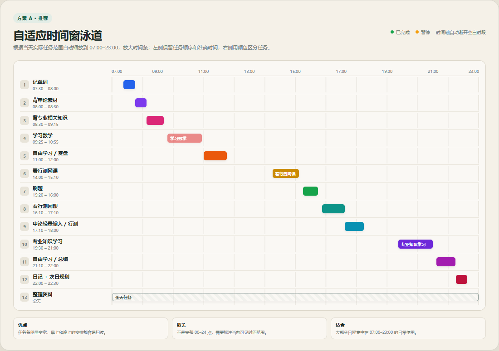
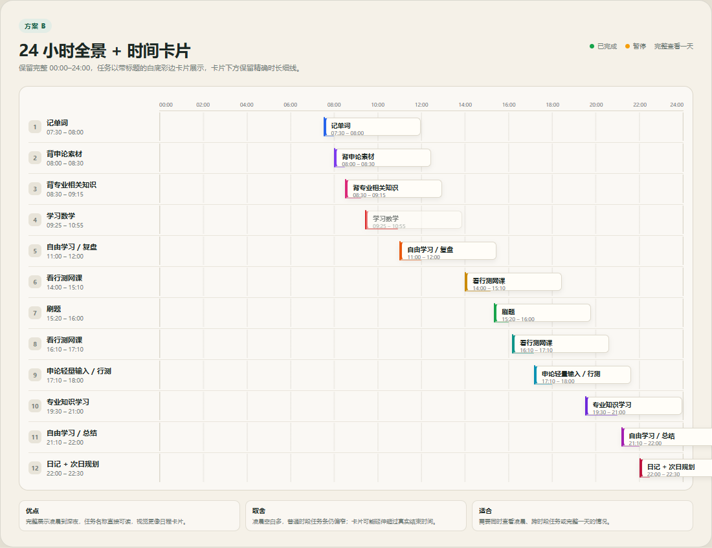
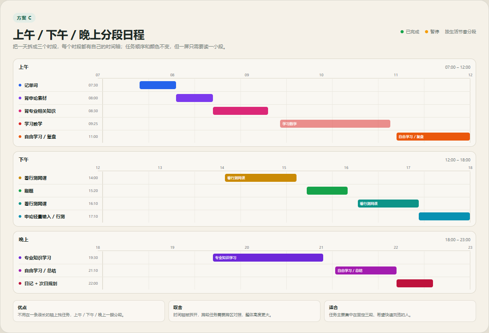

# 当天时间轴展示方案样图

> 已选择 **方案 C：上午 / 下午 / 晚上分段日程**（2026-11-09）。  
> 本文保留三套方案用于对照；最终实现规则见文末“已选方案”。

三个方案使用同一组示例任务，重点比较时间轴可读性、任务条宽度和一天的浏览方式。

## 方案 A：自适应时间窗泳道

- 根据当天任务实际范围自动缩放到 `07:00–23:00`。
- 左侧保留序号、任务名、准确时间段。
- 右侧时间条按真实时长绘制，并使用任务独立颜色。
- 已完成任务降低透明度。

**优点**：任务条明显变宽，早中晚安排一眼能扫完；最适合日常使用。

**取舍**：不是完整 00:00–24:00，需要标明当前可见时间范围。

**适合**：多数任务集中在 07:00–23:00 的日常安排。

## 方案 B：24 小时全景 + 时间卡片

- 保留完整 `00:00–24:00` 时间轴。
- 每个任务用白底彩边卡片展示标题和时间。
- 卡片下方用细线保留真实时长。

**优点**：完整查看一天，任务标题直接可读，视觉更像日程卡片。

**取舍**：凌晨空白较多，普通时段任务条仍偏窄；卡片为了可读性会延伸超过真实结束时间。

**适合**：需要同时查看凌晨、跨时段任务或完整一天的情况。

## 方案 C：上午 / 下午 / 晚上分段日程

- 将一天拆成三个时段，每个时段有独立时间轴。
- 任务颜色和先后顺序保持一致。

**优点**：不用在一条长轴上找任务，上午、下午、晚上一眼分段。

**取舍**：时间轴被拆开，跨段任务需要跨区对照，整体高度更大。

**适合**：任务主要集中在固定三段、希望快速浏览的人。

## 已选方案：C

最终采用“上午 / 下午 / 晚上分段日程”，并做以下调整：

- 任务名称和准确时间保留在左侧。
- 任务名称左侧放一个与文字同尺寸的彩色正方形方块。
- 右侧时间条不再显示任务名称，改为白色居中的“预计花费时间”。
- 时间格式：
  - 少于 60 分钟：`30分钟`
  - 恰好 60 分钟：`1小时`
  - 130 分钟：`2小时10分`
  - 显示空间不足时使用省略号。
- 已完成任务降低透明度，暂停任务使用虚线边框。
- 全天任务单独放在“全天”区域。
- 首页不展示时间轴；只有点击具体日期进入日期详情后才展示。

当前不打包、不上传，等待明确指示。
